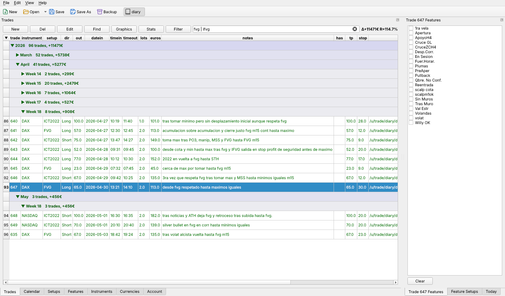
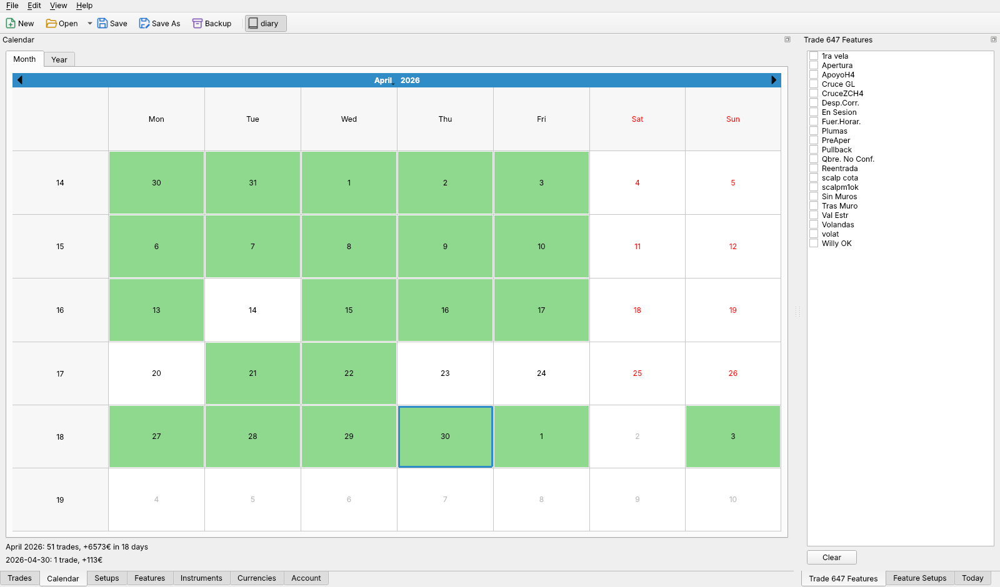
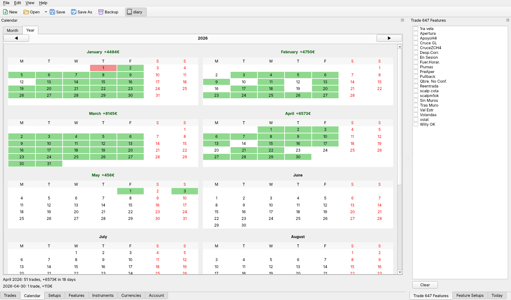
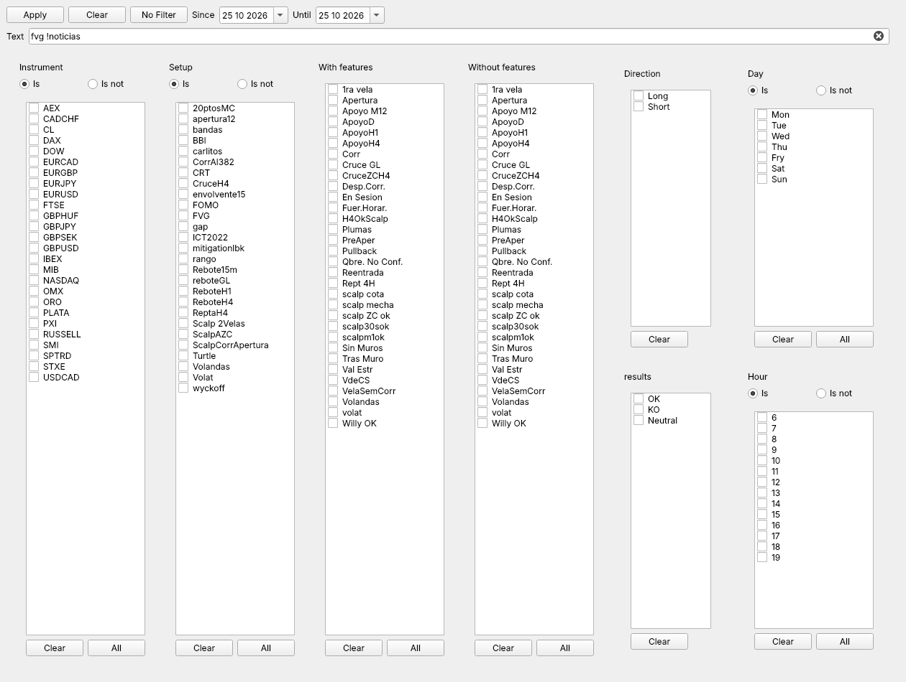
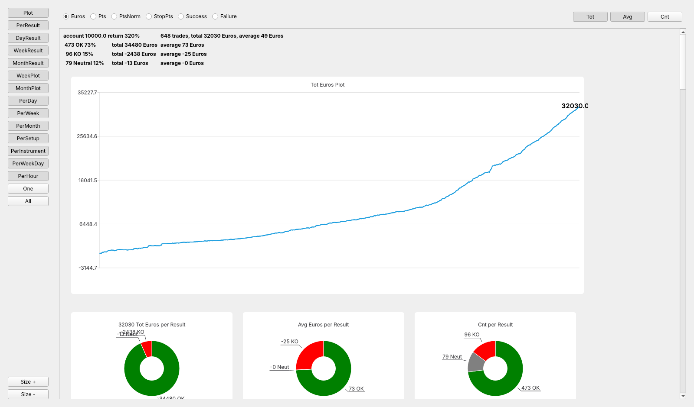
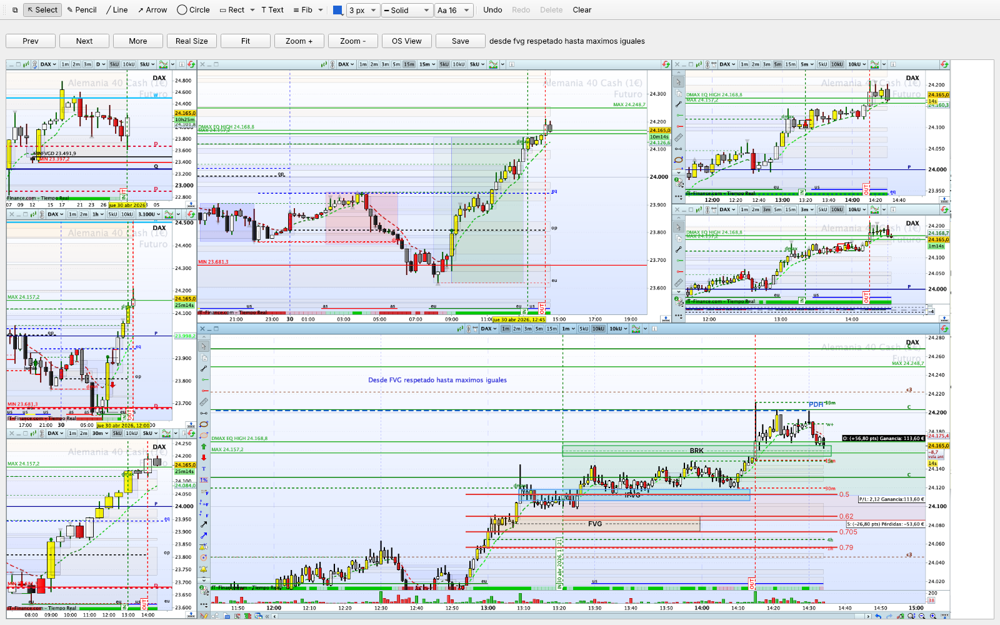

Still in alpha.
Just born for personal use.
For sure it's full of bugs.
Provided AS-IS

RoadBook (rb) is a trading journal: it keeps your trades with their setup,
features, notes and charts, and tells you which features make trades work.
See near the end for a quick use guide, the [user manual](docs/MANUAL.md)
for the details, and the [design document](docs/DESIGN.md) to find your way in the source.
There are PDFs of both in `docs`.

What it does:

- Trades grouped by year, month and week, with their totals; a calendar,
  by month or by year, colored by result.
- AutoFeatures, which reads the notes of the trades and checks the features
  named there (a final "s" is optional, and `*` in aka names matches any
  letters).
- Filters: by instrument, setup, features, direction, day, hour and dates,
  and a text filter with `!` (not), `|` (or) and parentheses, also in a
  quick box above the trades.
- Stats and plots per result, day, week, month, setup, instrument and hour.
- Charts for each trade, dropped on the trade form and read with OCR to
  fill in the trade; the graphics window can draw on them (lines, arrows,
  circles, rectangles with FVG, IFVG, BRK... presets, Fibonacci levels with
  OTE, quadrants, PO3 or your own levels, text and labels).
- Backups of the roadbook and its charts.

Uses PySide6 Qt for widgets, and easyocr to read the charts.

To build your exec just run

pyinstaller --noconfirm rb.spec

Or checkout [releases](https://github.com/fjballest/rb/releases) for binaries built at github.

Some screenshots:

The trades, grouped by month and week, with the quick text filter
(`fvg | ifvg`) and the features of the trade selected:

The calendar, by month and by year:

The filter window:

Stats:

The graphics window for a trade, with an FVG, an IFVG- and a BRK
rectangle, OTE Fibonacci levels and a labeled line drawn on the chart:

When started, it opens the roadbook used last, or one found in `/u/trade`,
the home directory or the documents directory (the one named `rb` if there
are several). When there is no `/u` directory it looks in `~/u/trade`, and
when there is no `~/u` either, in `trade` in the documents directory
(`~/Documents/trade/rb`, for example).

To create a new roadbook, use the new roadbook icon (empty file icon) and select
the directory where to create the roadbook and the name for the roadbook.

An example trade is included in it. Just edit this trade when you add the first
trade to the roadbook, and then add new ones as desired.

The roadbook data format is a directory that contains several CSV files with
trades, account information, setups, features, etc.
If everything fails, these can be at least imported to an excel.

To add a trade, click the New button and then select at least the instrument
and the setup from the drop-down menus.
Drop a PNG file to the form to add a capture that can be browsed later for the
trade.
PNGs are kept into a directory within the roadbook directory and are named
using the trade number (generated by this program) and the instrument for
the trade.
This permits using external tools to match PNGs to trades.

Fill the information for it and click on the features it has.

Before using one that is not recorded, it is suggested to create a new instrument,
setup, or feature first, in the tabs that list them.

This is just born and probably buggy.
It is sensible to make backups somewhere else for existing data.
It is also a good idea to save (click the save file icon) after adding a
few trades.

A click on the trades or features or setups tab selects a trade, and
then edit or delete can be used to edit or delete it.

Features are things that a trade might have for a particular setup, or for
any setup. They are have-or-don't-have things.

Instruments, Features, setups, etc. can be used to filter the trades
recorded before asking for stats.
Just click on filter and select the things you want or do not want in the
filter window.
Or use a start/end date to filter by time.

Stats displays several stats (use the buttons in the stats window to
show/hide each one of thme) for the, perhaps filtered, trades.

This can be used to learn which features make some trades more likely to
fail or succeed. This was the many reason I had to write this tiny tool.

Bug reports welcome.
Remember this was written just for my personal use, but I thought
others might want to use it too or perhaps take the code and make it better.

Have fun and good trades!
