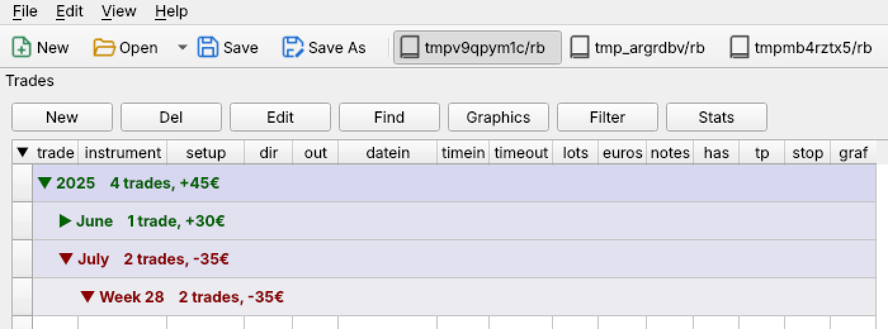
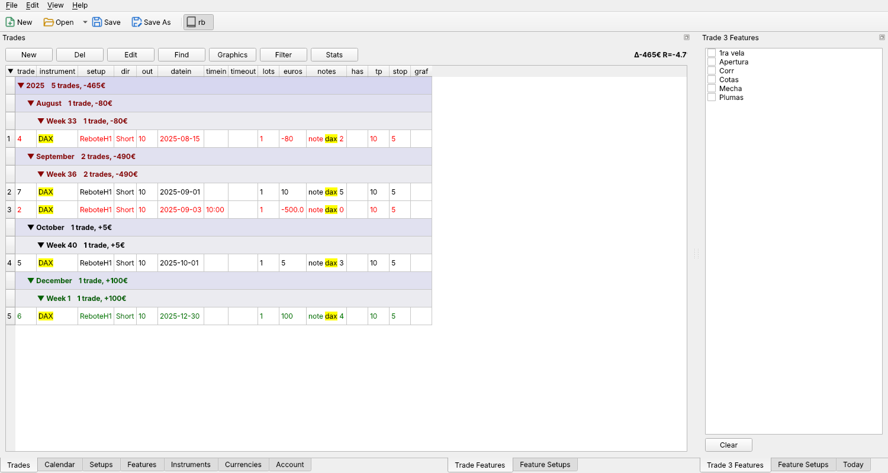
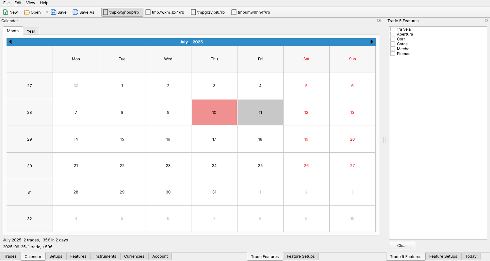
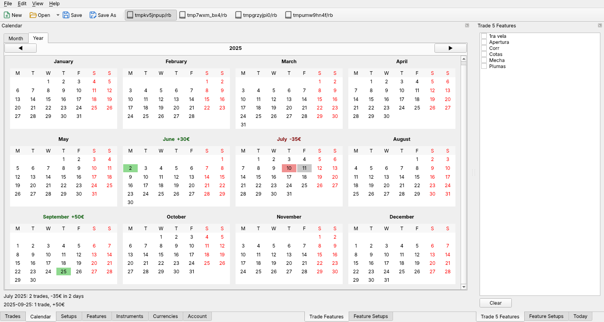
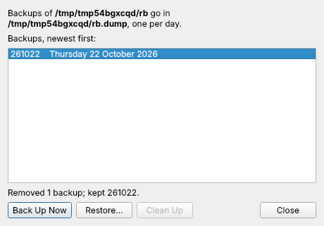

# RoadBook user manual

RoadBook is a trading diary. You record each trade with its setup, the
features it had, its result and screenshots of the chart, and then use
filters, statistics and a calendar to learn which setups and features work
for you.

Everything is kept in a *roadbook*: a directory of CSV files plus a
directory of graphs. You can have several roadbooks and switch between them.

## Contents

1. [Getting started](#getting-started)
2. [The main window](#the-main-window)
3. [Trades](#trades)
4. [Adding and editing a trade](#adding-and-editing-a-trade)
5. [Setups, features, instruments and currencies](#setups-features-instruments-and-currencies)
6. [Account](#account)
7. [Find and replace](#find-and-replace)
8. [The calendar](#the-calendar)
9. [The graphics window](#the-graphics-window)
10. [Filters](#filters)
11. [Statistics](#statistics)
12. [Saving, backups and the files on disk](#saving-backups-and-the-files-on-disk)
13. [Keyboard reference](#keyboard-reference)

## Getting started

Run `python3 rb.py` from the source directory, or the `rb` executable built
with `pyinstaller --noconfirm rb.spec`.

At start RoadBook opens, in this order:

1. the last roadbook you used, or
2. a roadbook found in `$RBDIR` (or `/u/trade` when `RBDIR` is not set),
   your home directory or your documents directory. If several are found,
   the one named `rb` is preferred.

To make your first roadbook, use **File ▸ New Roadbook…** (or the **New**
button) and choose a directory and name. It comes with a set of example
instruments, setups and features and one example trade. Edit or delete the
example trade once you add your own.

> The program is young. Keep a backup of your roadbook somewhere else, and
> save often.

## The main window

- **Toolbar**: New, Open (its ▾ lists recent roadbooks), Save, Save As and
  Backup,
  followed by a button for each of your most recent roadbooks. The one that
  is open is highlighted. Click another one to switch.
- **Left tabs**: Trades, Calendar, Setups, Features, Instruments,
  Currencies and Account.
- **Right panels**:
  - *Trade N Features*: the features of the selected trade, as check boxes.
    Checking or unchecking one changes the trade.
  - *Feature Setups*: the setups the selected feature applies to.
  - *Today*: pies with today's result.
- The window title shows the roadbook directory and "(unsaved)" when there
  are changes to save.

Any tab or panel can be dragged out to float in its own window, or
double-click its title bar. This is handy to see the Calendar and the Trades
side by side. **View ▸ Side Panels** shows or hides the right panels.

### Menus

| Menu | Entries |
|------|---------|
| File | New Roadbook (⌘N), Open Roadbook (⌘O), Open Recent, Save (⌘S), Save As (⌘⇧S), Backups (⌘B), Quit (⌘Q) |
| Edit | New Trade (⌘T), Edit Trade (⌘E), Delete Trade, Find and Replace (⌘F) |
| View | one entry per tab (⌘1 to ⌘7), Expand or Collapse All Trades (⌘⇧E), Graphics (⌘G), Filter (⌘⇧F), Statistics, Side Panels |
| Help | About |

On Windows and Linux use Ctrl instead of ⌘. On macOS, Quit and About are in
the application menu.

## Trades

The Trades tab lists the trades grouped by **year**, **month** and **week**
(ISO week numbers). Each group header shows how many trades it holds and
their total in euros, in green, red or black for a positive, negative or
neutral total.

- Click a group header to collapse or expand it. With the keyboard, move to
  a header and use Enter or Space to toggle it, ← to collapse and → to
  expand.
- The tiny triangle in the top-left corner of the table collapses every
  group (▼) or, when all are collapsed, expands them all again (▶).
- At start only the latest year, month and week are open. When the last
  week has just started (its last trade is on a Monday or Tuesday), the week
  before stays open too.
- Trades are sorted by date and time inside the groups. Trade numbers are
  given by the program and cannot be edited.
- Trade rows are green, red or black by result. A trade is positive when its
  euros (or points, when euros is zero) are above the account's *neutral*
  value, negative when below minus that value, and neutral otherwise.
- The label at the right of the buttons shows the total and the return on
  the account for the trades listed (all of them, or the filtered ones).

Cells can be edited in place by double-clicking them. Editing the date moves
the trade to its new group and keeps it selected.

Buttons:

| Button | What it does |
|--------|--------------|
| New | opens the trade form for a new trade |
| Del | deletes the selected trade |
| Edit | opens the trade form for the selected trade |
| Find | opens find and replace |
| Graphics | shows the graphs of the selected trade |
| Filter | opens the filter window |
| Stats | opens the statistics window |

You can also drop PNG files on the trades table to start a new trade with
them.

Selecting a trade updates the *Trade Features* panel, moves the calendar to
its day, and refreshes the graphics window if it is open.

## Adding and editing a trade

The trade form has these fields:

| Field | Meaning |
|-------|---------|
| Instrument | what was traded, from the instruments list (you may type a new one) |
| Setup | the setup used, from the setups list (you may type a new one) |
| Date, Time In, Time Out | when the trade was opened and closed |
| Dir | Long or Short |
| Size | size in lots |
| TP Δpts | distance to the take profit, in points |
| Stop Δpts | distance to the stop, in points |
| Out Δpts | points won (positive) or lost (negative) |
| Tp at, Out at, Stop at | optional prices. If you give entry and exit prices, the points are computed from them |
| Euros Out | the money result; if left at zero, it is computed from the points, the size, the instrument's money per point and its currency |
| Graphics | the screenshots of the trade |
| Notes | free text |

Check the features the trade had in the list of the form. If you type an
instrument, setup or feature that does not exist yet, it is added to the
roadbook when you accept.

### Screenshots

Drop one or more PNG files on the form. When the trade has no graphs yet,
RoadBook reads them with OCR and picks the one that best looks like a trade
screenshot (a known instrument, TP, stop, result, size, time) as the
*primary* graph, and uses it to fill in empty fields. The others become extra
graphs. The first OCR takes a while because the OCR engine loads then.

Dropping more files on an existing trade adds them as extra graphs. When you
accept, new graphs are copied into the roadbook as
`diarygraphs/trade<N><instrument>.png` for the primary one and
`trade<N><instrument>.<k>.png` for the others. Graphs that are already in the
roadbook are kept as they are, and existing files are never overwritten.
Because the names carry the trade number, other tools can match graphs to
trades.

## Setups, features, instruments and currencies

Each one has its own tab with a table you can edit in place, and New and Del
buttons.

- **Setups**: the kinds of trades you take, with a description.
- **Features**: things a trade may or may not have ("with" or "without"),
  with a description and the setups they apply to. A feature with no setups
  applies to all. Select a feature to edit its setups in the *Feature
  Setups* panel. The **aka** column lists other names for the feature,
  separated by `;` as in the trades' features (for example
  `Primera;1st candle`).
  Two more buttons act on the trades listed (the filtered ones when a
  filter is on). **ClearAll** removes every feature from those trades, after
  asking. **AutoFeatures** reads their notes and adds each feature whose
  name or aka name appears there as a whole word, ignoring case; a feature
  restricted to some setups is only added to trades of those setups. A
  final lowercase `s` is optional, so `EQL` matches `EQLs` (and `EQLs`
  matches `EQL`). In aka names a `*` matches any letters within the word,
  so `EQ*` matches `EQL`, `EQH` and `EQLs`.
- **Instruments**: what you trade. Besides its name it has an alias, its
  currency, the money per point (`pipmoney`), the point size and a scale
  used to normalize points between instruments, among others.
- **Currencies**: name, forex pair and value in euros, used to convert
  results to euros.

Renaming a setup, feature, instrument or currency updates every trade (and
feature or instrument) that uses it. Names must be unique and cannot be
empty. Something that is in use cannot be deleted; RoadBook tells you so.

## Account

The Account tab holds:

- **Account**: the account size, used for the return percentage.
- **Neutral**: the result, in euros, below which a trade, a day or a group
  counts as neutral rather than positive or negative.
- **Fixed risk**: kept in the roadbook. It does not change any computation
  yet.
- **Copy Graphs**: whether Save As also copies the graphs.

## Find and replace

**Edit ▸ Find and Replace** (⌘F) or the **Find** button of any table opens
the find window for the table you are looking at.

- **Find next** and **Find previous** move through the matches, wrapping
  around at the ends. All matches are highlighted in yellow and the current
  one in orange. Matches inside collapsed groups are found too; their groups
  open as needed.
- **Case sensitive** and **Whole words** narrow the search.
- **Replace** changes the current match and moves to the next one.
  **Replace all** changes every match. The status line says how many were
  changed and how many were refused.
- Read-only cells (such as the trade number), invalid values and names that
  are already in use are refused.

Replacing keeps the roadbook coherent. Replacing an instrument, setup or
feature name inside trades adds it to the roadbook if it is new, and
replacing a name in the Setups, Features, Instruments or Currencies tables
renames it everywhere.

## The calendar

The Calendar tab shows the days with trades in green, red or grey for a
positive, negative or neutral daily total (by the same *neutral* rule as
trades). It follows the filter, when there is one.

- **Click a day** to select its first trade in the trades table. The
  graphics window, if open, shows that trade.
- **Double-click a day** to do the same and switch to the Trades tab.
- **Moving to another month** collapses the trades table to show that month.
  Months without trades leave it alone.
- Below the calendar you see the month's total and the clicked day's total.
  Hover over a day to see its total too.

The **Year** tab shows all twelve months of a year with the same colours.
Scroll down to see them all, and use ◀ ▶ to change the year. Each month title
shows its total; click it to show that month in the trades table. Clicking a
day works as in the month view.

## The graphics window

Opened with the **Graphics** button or **View ▸ Graphics** (⌘G). It shows
the graphs of the selected trade, with the trade's notes beside the buttons
(hover over them to read notes longer than three lines).

| Control | What it does |
|---------|--------------|
| Prev, Next or ↑ ↓ | previous or next trade |
| More, or ← → | previous or next graph of the same trade, wrapping around |
| Home, End | first or last trade |
| Real Size | shows the graph at its real size |
| Fit | fits the graph to the window |
| Zoom +, Zoom − | zooms in or out |
| Double click | zooms in, zooms in again, then back to fit, in turns. Zooming keeps the point you clicked under the mouse |
| Drag | moves the graph around when it is larger than the window |
| OS View | opens the graph in the system viewer |
| Save (⌘S) | saves the drawings |

The zoom mode sticks: Real Size, Fit or a zoom factor stay in use as you move
through graphs and trades.

### Drawing on the graphs

The toolbar at the top of the graphics window draws on the graph:

| Tool | Key | What it does |
|------|-----|--------------|
| Select | S | click a drawing to select it, shift-click to add more, drag to move them; drag the graph itself to move around |
| Pencil | P | draws free hand |
| Line, Arrow | L, A | drag from one end to the other; hold shift when you let go to keep it horizontal or vertical |
| Circle | C | drag across the box of a circle or ellipse |
| Text | T | click where the text goes and type; click elsewhere to finish. Double click a text to edit it again |

**Color** and the width box set how the next drawings look, and change the
ones selected. **Undo** (⌘Z) and **Redo** (⌘⇧Z) go back and forth through
the changes made to the graph shown; **Delete** (or Del) removes what is
selected and Esc unselects it and goes back to Select. Drawings stay on their
place on the graph when you zoom.

Drawings are not saved until you press **Save** (⌘S); until then the title
says *(unsaved)*. You can move to other graphs and trades and save them all
later. Closing the window or quitting asks whether to save them. The drawings
of a graph are kept next to it, with its name and the `.drw` extension:
`diarygraphs/trade12dax.png` has its drawings in `diarygraphs/trade12dax.drw`.
A graph with no drawings left has no `.drw` file.

## Filters

**Filter** opens the filter window. Pick:

- instruments and setups, each with **Is** or **Is not** to keep or drop the
  checked ones,
- features the trades must have (*With features*) or must not have
  (*Without features*),
- direction and result,
- day of the week and hour, again with **Is** or **Is not**,
- a **Since** and **Until** date range (ignored when Since is not before
  Until),
- a **Text** expression (see below; Enter applies it).

**Apply** filters the trades table, the totals, the calendar and the
statistics. **Clear** resets the choices, and **No Filter** shows all trades
again.

### Text filter

The box after the buttons of the Trades tab filters as you type, and the
same expression can go in the filter window's **Text** box. Both filters
apply together. An empty box doesn't filter.

A word matches a trade when it is a whole word of the trade's notes or of
one of its features, ignoring case. As in AutoFeatures, a final lowercase
`s` is optional (`eql` finds EQLs) and `*` matches any letters within a word
(`EQ*`).

| Expression | Trades shown |
|------------|--------------|
| `late entry` | with both words (words one after another mean *and*) |
| `late \| early` | with either word |
| `!late` | without the word |
| `(a b) \| !(c d)` | with a and b, or without both c and d together |

`!` applies to the word or parenthesis right after it, *and* comes before
`|`. A wrong expression turns red and its tooltip says why; the trades stay
as they were until it is fixed. Esc empties the box. Opening another
roadbook clears both filters.

## Statistics

**Stats** opens the statistics window for the trades listed (filtered or
not).

- The radio buttons at the top choose the unit: Euros, points (Pts),
  normalized points (PtsNorm), stop points, successes or failures.
- **Tot**, **Avg** and **Cnt** choose totals, averages and counts.
- The buttons on the left show or hide each chart: the cumulative plot,
  results split by positive, negative and neutral, results per day, week and
  month, and totals per day, week, month, setup, instrument, weekday and
  hour. **One** and **All** show one or all charts, and **Size +** and
  **Size −** make them larger or smaller.

Comparing these with filters on different features is the point of the
program: it shows which features make trades more likely to fail or succeed.

## Saving, backups and the files on disk

**Save** (⌘S) writes the roadbook. Each file is written to a temporary file
first and then put in place, so a crash while saving does not leave half a
file. The previous version of each CSV is kept with a `~` suffix.

**Save As** writes the trades listed (so, with a filter on, only the filtered
ones) to another directory, and copies their graphs when the account's *Copy
Graphs* is set. The open roadbook stays the same.

RoadBook warns you before quitting or opening another roadbook with unsaved
changes.

### Backups

The **Backup** button (or **File ▸ Backups…**, ⌘B) opens the backups window.
Backups of a roadbook at `/a/b/rb` go in `/a/b/rb.dump/`, one directory per
day named `YYMMDD` (for example `261022`). Each one holds a copy of the
roadbook's CSV files, graphs and drawings with the same layout they have in the
roadbook.

- **Back Up Now** makes today's backup. If the roadbook has unsaved changes
  it offers to save them first; otherwise the backup has what is on disk.
  Backing up again the same day replaces that day's backup, so there is only
  one per day. The new backup is written aside and only replaces the old one
  when it is complete.
- **Restore…** (or double-clicking a backup) copies the chosen backup's CSV
  files, graphs and drawings back into the roadbook, after you confirm, and reloads it.
  Changes made since that backup are lost, including unsaved ones. Graph
  files added after the backup are left in place.
- **Del** deletes the selected backup, after you confirm.
- **Clean Up** removes all backups but the newest one, after you confirm.

A roadbook directory holds:

| File | Contents |
|------|----------|
| `account.csv` | the account settings |
| `trades.csv` | the trades |
| `setups.csv` | the setups |
| `features.csv` | the features |
| `activos.csv` | the instruments |
| `divisas.csv` | the currencies |
| `diarygraphs/` | the graphs, as PNG |

The CSV files use `;` as separator and can be opened with a spreadsheet if
everything else fails. Sets and lists inside a cell (features, graphs) are
also separated by `;`. Roadbooks written by older versions are converted
when opened.

## Keyboard reference

| Where | Keys | Action |
|-------|------|--------|
| Anywhere | ⌘N, ⌘O, ⌘S, ⌘⇧S, ⌘B, ⌘Q | new, open, save, save as, backups, quit |
| Anywhere | ⌘T, ⌘E | new trade, edit trade |
| Anywhere | ⌘F | find and replace in the table shown |
| Anywhere | ⌘1 … ⌘7 | show a tab |
| Anywhere | ⌘G, ⌘⇧F, ⌘⇧E | graphics, filter, expand or collapse all trades |
| Tables | Home, End | scroll to the top or bottom |
| Trades, on a group | Enter, Space, ←, → | toggle, toggle, collapse, expand |
| Graphics window | ← → | previous or next graph of the trade |
| Graphics window | ↑ ↓ | previous or next trade |
| Graphics window | Home, End | first or last trade |
| Graphics window | S, P, L, A, C, T | select, pencil, line, arrow, circle, text |
| Graphics window | ⌘Z, ⌘⇧Z, Del, Esc | undo, redo, delete the drawings selected, unselect |
| Graphics window | ⌘S | save the drawings |
