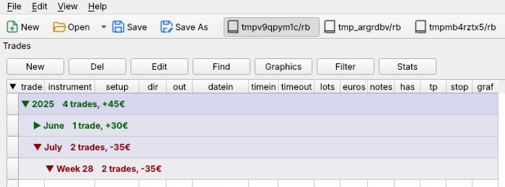
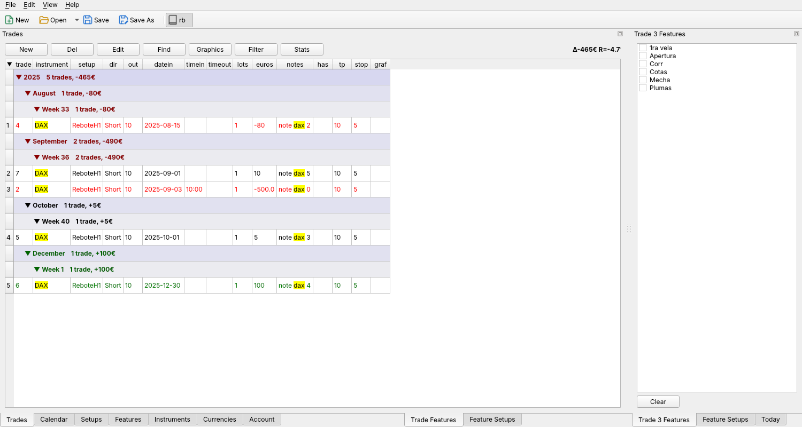
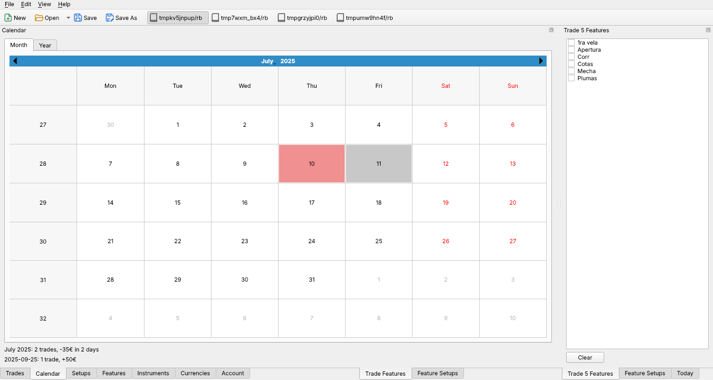
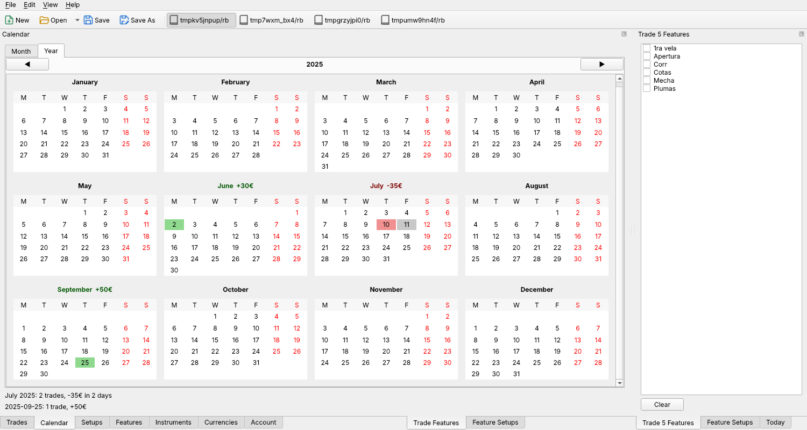
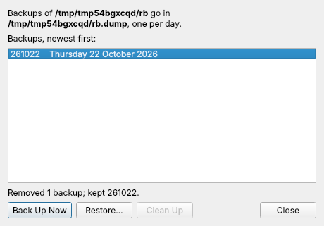

# RoadBook user manual

RoadBook is a trading diary. You record each trade with its setup, the
features it had, its result and screenshots of the chart, and then use
filters, statistics and a calendar to learn which setups and features work
for you.

Everything is kept in a *roadbook*: a directory of CSV files plus a
directory of graphs. You can have several roadbooks and switch between them.

## Contents

1. [Getting started](#getting-started)
2. [The main window](#the-main-window)
3. [Trades](#trades)
4. [Adding and editing a trade](#adding-and-editing-a-trade)
5. [Setups, features, instruments and currencies](#setups-features-instruments-and-currencies)
6. [Account](#account)
7. [Find and replace](#find-and-replace)
8. [The calendar](#the-calendar)
9. [The graphics window](#the-graphics-window)
10. [Filters](#filters)
11. [Statistics](#statistics)
12. [Saving, backups and the files on disk](#saving-backups-and-the-files-on-disk)
13. [Help](#help)
14. [Keyboard reference](#keyboard-reference)

## Getting started

Run `python3 rb.py` from the source directory, or the `rb` executable built
with `pyinstaller --noconfirm rb.spec`.

At start RoadBook opens, in this order:

1. the last roadbook you used, or
2. a roadbook found in `$RBDIR` (or `/u/trade` when `RBDIR` is not set),
   your home directory or your documents directory. If several are found,
   the one named `rb` is preferred. Without `RBDIR`, when there is no `/u`
   directory it looks in `~/u/trade`, and when there is no `~/u` either, in
   `trade` in your documents directory (`~/Documents/trade` on macOS,
   `Documents\trade` on Windows). New, Open and Save As start there too.

To make your first roadbook, use **File ▸ New Roadbook…** (or the **New**
button) and choose a directory and name. It comes with a set of example
instruments, setups and features and one example trade. Edit or delete the
example trade once you add your own.

> The program is young. Keep a backup of your roadbook somewhere else, and
> save often.

## The main window

- **Toolbar**: New, Open (its ▾ lists recent roadbooks), Save, Save As and
  Backup,
  followed by a button for each of your most recent roadbooks. The one that
  is open is highlighted. Click another one to switch.
- **Left tabs**: Trades, Calendar, Setups, Features, Instruments,
  Currencies and Account.
- **Right panels**:
  - *Trade N Features*: the features of the selected trade, as check boxes.
    Checking or unchecking one changes the trade.
  - *Feature Setups*: the setups the selected feature applies to.
  - *Today*: pies with today's result.
- The window title shows the roadbook directory and "(unsaved)" when there
  are changes to save.

Any tab or panel can be dragged out to float in its own window, or
double-click its title bar. This is handy to see the Calendar and the Trades
side by side. **View ▸ Side Panels** shows or hides the right panels.

### Menus

| Menu | Entries |
|------|---------|
| File | New Roadbook (⌘N), Open Roadbook (⌘O), Open Recent, Save (⌘S), Save As (⌘⇧S), Backups (⌘B), Quit (⌘Q) |
| Edit | New Trade (⌘T), Edit Trade (⌘E), Delete Trade, Recompute Euros of Trade, Recompute Euros of Trades Listed, Find and Replace (⌘F) |
| View | one entry per tab (⌘1 to ⌘7), Expand or Collapse All Trades (⌘⇧E), Graphics (⌘G), Filter (⌘⇧F), Statistics, Side Panels |
| Window | Minimize (⌘M), layouts for the windows shown (Tile ⌥⌘T), the windows shown |
| Help | User Guide (⌘?), About |

On Windows and Linux use Ctrl instead of ⌘. On macOS, Quit and About are in
the application menu.

**Window** arranges the windows shown (the main one, the graphics windows and their
copies, filters, statistics) on the screen of the one you are in,
which goes first:

| Entry | What it does |
|-------|--------------|
| Minimize (⌘M) | minimizes this window |
| Tile (⌥⌘T) | all the windows as a mosaic: two side by side, three with one wide below, four in a 2×2 grid, and so on |
| Side by Side | all the windows in columns |
| Stacked | all the windows in rows |
| Main on the Left | this window on the left half, the others one over the other on the right |
| Main on Top | this window on the top half, the others side by side below |
| Cascade | all the windows a bit apart, one over the other |
| Fill the Screen, Left Half, Right Half, Top Half, Bottom Half, Center | this window alone |

At the end it lists the windows shown, to bring one to the front. The
other windows keep more or less their order on the screen. A window that
can't get as small as its place keeps its smallest size and stays on the
screen.
On macOS the graphics windows have the Window menu too.

## Trades

The Trades tab lists the trades grouped by **year**, **month** and **week**
(ISO week numbers). Each group header shows how many trades it holds and
their total in euros, in green, red or black for a positive, negative or
neutral total.

- Click a group header to collapse or expand it. With the keyboard, move to
  a header and use Enter or Space to toggle it, ← to collapse and → to
  expand.
- The tiny triangle in the top-left corner of the table collapses every
  group (▼) or, when all are collapsed, expands them all again (▶).
- At start only the latest year, month and week are open. When the last
  week has just started (its last trade is on a Monday or Tuesday), the week
  before stays open too.
- Trades are sorted by date and time inside the groups. Trade numbers are
  given by the program and cannot be edited.
- Trade rows are green, red or black by result. A trade is positive when its
  euros (or points, when euros is zero) are above the account's *neutral*
  value, negative when below minus that value, and neutral otherwise.
- The label at the right of the buttons shows the total and the return on
  the account for the trades listed (all of them, or the filtered ones).

Cells can be edited in place by double-clicking them. Editing the date moves
the trade to its new group and keeps it selected.

Buttons:

| Button | What it does |
|--------|--------------|
| New | opens the trade form for a new trade |
| Del | deletes the selected trade |
| Edit | opens the trade form for the selected trade |
| Find | opens find and replace |
| Graphics | shows the graphs of the selected trade |
| Filter | opens the filter window |
| Stats | opens the statistics window |

You can also drop PNG files on the trades table to start a new trade with
them.

Selecting a trade updates the *Trade Features* panel, moves the calendar to
its day, and refreshes the graphics window if it is open.

## Adding and editing a trade

The trade form has these fields:

| Field | Meaning |
|-------|---------|
| Instrument | what was traded, from the instruments list (you may type a new one) |
| Setup | the setup used, from the setups list (you may type a new one) |
| Date, Time In, Time Out | when the trade was opened and closed |
| Dir | Long or Short |
| Size | size in lots |
| TP Δpts | distance to the take profit, in points |
| Stop Δpts | distance to the stop, in points |
| Out Δpts | points won (positive) or lost (negative) |
| Tp at, Out at, Stop at | optional prices. If you give entry and exit prices, the points are computed from them |
| Euros Out | the money result; if left at zero, it is computed from the points, the size, the instrument's money per point and its currency |
| Graphics | the screenshots of the trade |
| Notes | free text |

Check the features the trade had in the list of the form. The
**AutoFeatures** button below the list checks the features named in the
form's notes, as the Features tab's AutoFeatures does (see below), but only
for this trade and for the setup chosen in the form. It checks features
only, it never unchecks any, and nothing is saved until you press OK. If you
type an instrument, setup or feature that does not exist yet, it is added to
the roadbook when you accept.

When you drop captures on the form, **Tags read** shows next to the notes
the words read from them that name a feature of the setup, or one of its
aka names, or look much like one (a misread `sin muro` for Sin Muros). The
misreads of one feature make a single tag, named by the word read most like
it: Londont, Londdn and London are just London.
Names shorter than five letters are suggested only when read as they are, so
FVG is not taken for IFVG. Hover a tag to see its feature and the other ways
it was read. Click the tags you want, and click one again to drop it;
AutoFeatures checks the features of the tags picked too, as if they were in
the notes. Tags are only suggestions: they are not saved with the trade.

### Screenshots

Drop one or more PNG files on the form. When the trade has no graphs yet,
RoadBook reads them with OCR and picks the one that best looks like a trade
screenshot (a known instrument, TP, stop, result, size, time) as the
*primary* graph, and uses it to fill in empty fields. The others become extra
graphs. The first OCR takes a while because the OCR engine loads then.

What the OCR looks for, in TradingView captures:

- **Instrument:** the one named most in the capture, by its name or its aka
  expressions (see Instruments below). With the usual ones, MNQ1!, NQ…, Micro
  or E-mini Nasdaq, NASDAX, US100 or USTEC are the NASDAQ; FDAX, FDXM, GER40,
  DE40 or Alemania 40 are the DAX; ES1!, ESZ2025, MESH26 or E-mini S&P 500
  are the SP500.
- **Long or short:** where the position's labels are. A stop below the
  target (or below the entry, the label in the middle) is a long; a stop
  above it is a short.
- **Times:** the labels of the time axis, the green one for the entry and the
  red one for the exit (the latest of each, as charts with longer bars round
  them down), and the trade's date from them. Chart times are turned into
  local time: from the zone the chart shows (*UTC-5*), or New York for the
  Nasdaq when it shows none.

Dropping more files on an existing trade adds them as extra graphs. When you
accept, new graphs are copied into the roadbook as
`diarygraphs/trade<N><instrument>.png` for the primary one and
`trade<N><instrument>.<k>.png` for the others. Graphs that are already in the
roadbook are kept as they are, and existing files are never overwritten.
Because the names carry the trade number, other tools can match graphs to
trades.

## Setups, features, instruments and currencies

Each one has its own tab with a table you can edit in place, and New and Del
buttons.

- **Setups**: the kinds of trades you take, with a description.
- **Features**: things a trade may or may not have ("with" or "without"),
  with a description and the setups they apply to. A feature with no setups
  applies to all. Select a feature to edit its setups in the *Feature
  Setups* panel. The **aka** column lists other names for the feature,
  separated by `;` as in the trades' features (for example
  `Primera;1st candle`).
  Two more buttons act on the trades listed (the filtered ones when a
  filter is on). **ClearAll** removes every feature from those trades, after
  asking. **AutoFeatures** reads their notes and adds each feature whose
  name or aka name appears there as a whole word, ignoring case; a feature
  restricted to some setups is only added to trades of those setups. A
  final lowercase `s` is optional, so `EQL` matches `EQLs` (and `EQLs`
  matches `EQL`). In aka names a `*` matches any letters within the word,
  so `EQ*` matches `EQL`, `EQH` and `EQLs`.
- **Instruments**: what you trade. Besides its name it has its currency, the
  money per point (`pipmoney`), the point size and a scale used to normalize
  points between instruments, among others. The **aka** column lists, split
  by `;`, expressions for other names of the instrument, compared ignoring
  case: `*X*` is a word that has X, `X*` one that starts with X, `*X` one
  that ends with X, and `X` the word X; a space also matches no space, so
  `GER 40*` matches GER40. For example `MNQ*;NQ*` for the Nasdaq futures, or
  `SPTRD;ES1!;ESZ2*;MESZ2*` for the SP500. A trade, a typed instrument or an
  OCR'd one that matches an aka gets the instrument's name, so SPTRD becomes
  SP500 and MNQU2026 the NASDAQ. A NASDAQ, DAX or SP500 with no aka gets the
  usual expressions for it.
- **Currencies**: name, forex pair and its rate, used to convert results to
  euros. The rate is read as the pair says, with or without a slash: for
  `EUR/USD` 1.17 it is dollars per euro, so a dollar is 1/1.17 euros; for
  `USD/EUR`, or no pair, it is what one unit is worth in euros. A pair
  without the euro goes through the other currency: with `GBPSEK` 10.92 a
  crown is 1/10.92 pounds, and the pound row says what a pound is in euros.
  **Update**, below the table, sets the rates from the euro's reference
  rates of the day, published by the European Central Bank, each as its
  pair says (GBPSEK gets crowns per pound). It needs the Internet, and
  currencies the ECB has no rate for are left as they were. Recompute the
  euros of the trades afterwards to use the new rates.

The euros of a trade, when left at zero in its form, are its points times
its size times the instrument's money per point, in the instrument's
currency converted to euros: 100 points with 2 contracts of an instrument
at $2 a point are $400. **Edit ▸ Recompute Euros of Trade** does that again
for the selected trade, and **Recompute Euros of Trades Listed** for all the
trades listed (the filtered ones when there is a filter), after asking.
Earlier versions left the money per point out when filling in the euros,
so recompute the trades entered with them.

Renaming a setup, feature, instrument or currency updates every trade (and
feature or instrument) that uses it. Names must be unique and cannot be
empty. Something that is in use cannot be deleted; RoadBook tells you so.

## Account

The Account tab holds:

- **Account**: the account size, used for the return percentage.
- **Neutral**: the result, in euros, below which a trade, a day or a group
  counts as neutral rather than positive or negative.
- **Fixed risk**: kept in the roadbook. It does not change any computation
  yet.
- **Copy Graphs**: whether Save As also copies the graphs.

## Find and replace

**Edit ▸ Find and Replace** (⌘F) or the **Find** button of any table opens
the find window for the table you are looking at.

- **Find next** and **Find previous** move through the matches, wrapping
  around at the ends. All matches are highlighted in yellow and the current
  one in orange. Matches inside collapsed groups are found too; their groups
  open as needed.
- **Case sensitive** and **Whole words** narrow the search.
- **Replace** changes the current match and moves to the next one.
  **Replace all** changes every match. The status line says how many were
  changed and how many were refused.
- Read-only cells (such as the trade number), invalid values and names that
  are already in use are refused.

Replacing keeps the roadbook coherent. Replacing an instrument, setup or
feature name inside trades adds it to the roadbook if it is new, and
replacing a name in the Setups, Features, Instruments or Currencies tables
renames it everywhere.

## The calendar

The Calendar tab shows the days with trades in green, red or grey for a
positive, negative or neutral daily total (by the same *neutral* rule as
trades). It follows the filter, when there is one.

- **Click a day** to select its first trade in the trades table. The
  graphics window, if open, shows that trade.
- **Double-click a day** to do the same and switch to the Trades tab.
- **Moving to another month** collapses the trades table to show that month.
  Months without trades leave it alone.
- Below the calendar you see the month's total and the clicked day's total.
  Hover over a day to see its total too.

The **Year** tab shows all twelve months of a year with the same colours.
Scroll down to see them all, and use ◀ ▶ to change the year. Each month title
shows its total; click it to show that month in the trades table. Clicking a
day works as in the month view.

## The graphics window

Opened with the **Graphics** button or **View ▸ Graphics** (⌘G). It shows
the graphs of the selected trade, with the trade's notes beside the buttons
(hover over them to read notes longer than three lines). Its title is
*Trade* and the path of the graph shown.

| Control | What it does |
|---------|--------------|
| Prev, Next or ↑ ↓ | previous or next trade |
| More, or ← → | previous or next graph of the same trade, wrapping around |
| Home, End | first or last trade |
| Real Size | shows the graph at its real size |
| Fit | fits the graph to the window |
| Zoom +, Zoom − | zooms in or out |
| Double click | zooms in, zooms in again, then back to fit, in turns. Zooming keeps the point you clicked under the mouse |
| Two finger double tap, pinch | on a trackpad, zoom like a double click, and in and out |
| Drag | moves the graph around when it is larger than the window |
| OS View | opens the graph in the system viewer, with the drawings shown on it, as a PNG at its size |
| Save (⌘S) | saves the drawings |
| Dup | opens a copy of the window, titled *View* and the path of the graph, to see several graphs at once |

A window opened with **Dup** stays with the graphs of its trade: Prev, Next,
↑ ↓, Home and End do nothing there, but More and ← → go through the graphs
of the trade, and you can zoom and draw as in the main one. Dup it again for
more of them. Each one keeps its own unsaved drawings; quitting asks about
those of every window.

The zoom mode sticks: Real Size, Fit or a zoom factor stay in use as you move
through graphs and trades.

### Drawing on the graphs

The toolbar at the top of the graphics window draws on the graph:

| Tool | Key | What it does |
|------|-----|--------------|
| Select | S | click a drawing to select it, shift-click to add more, drag to move them; drag a handle (the small squares on the one selected: a line's ends, a box's corners and sides, a fib's points and right end) to reshape it, a side moving only that side, and shift keeping a line's end or a corner level or plumb; drag the graph itself to move around |
| Pencil | P | draws free hand |
| Line, Arrow | L, A | drag from one end to the other; hold shift when you let go to keep it horizontal or vertical |
| Circle | C | drag across the box of a circle or ellipse. Double click a line, arrow or circle for its color, width, style and label |
| Rect | R | drag across a rectangle; double click it for its fill, middle line and label |
| Text | T | click where the text goes and type; click elsewhere to finish. Double click a text to edit it again |
| Fib | F | Fibonacci levels; see below |

**Line**, **Arrow** and **Circle** open a window when you double click
them, to change their **Color**, **Width** and **Style** (solid, dashed,
dotted) and give them a **Label**, with its **Text size** and **Label
color**. The label goes **Above**, **Center** (across it; the line stops
around the label) or **Below**, and **Left** (at its left end), **Center**
(in its middle) or **Right**. For lines and arrows, **Right** puts the label
past the right end of the line, kept inside the image.
A line (not an arrow) also has **Extend across the image**: a horizontal
line then goes from the left edge to the right one, a vertical one from top
to bottom, and any other to where it meets the edges. Its ends stay where
they were, for its handles. Extended, **Left** and **Right** put the label
at that end of the line, across it, and the line stops before it (for a
vertical line the form says **Top** and **Bottom**); **Center** keeps it in
the middle of its two points.

To copy drawings, select them and press ⌘C (Ctrl+C elsewhere). ⌘V pastes
them under the mouse, selected, on this image or on another one (in
DayJournal or RoadBook); with the mouse off the image they go a little to
the side of where they were. **Undo** removes them.

**Rect** draws a rectangle, just its border at first. Double click its
border (anywhere on it once filled) to set:

- **Width** and **Style** (solid, dashed or dotted) of its border;
- **Fill**, with its color and **Transparency** (0% hides what is under it);
- **Line across the middle**, dashed, with its color;
- **Label** (FVG, OB...), aligned **Center**, **Left** or **Right**, written
  across the middle of the rectangle (the middle line stops around it), with
  its **Label color**.

The arrow next to **Rect** picks the kind of rectangle to draw: **Plain**
(just the border, in the drawing color) or one already set up, with its
colors, fill, middle line and label:

| Kind | Looks like |
|------|------------|
| BRK | green border and fill, green middle line |
| MB | green border and fill, green middle line |
| FVG | black border, light orange fill, black middle line |
| IFVG+ | orange border and fill, red middle line |
| IFVG- | blue border, light cyan fill, black middle line |

Picking a kind with rectangles selected changes them to it instead.

In these windows the drawing shows each change at once, colors too while
you pick them; **OK** keeps the result and **Cancel** puts it back as it
was.

**Fib** draws Fibonacci levels. Press on the first point (level 1) and drag
to the second one (level 0), or click one and then the other. Then move the
mouse and click where the lines end, or double click on the second point to
take them to the right edge of the image. While you draw it, a dashed line
shows where the second point (level 0) is. Esc or the right button drops a
fib not finished. Each level has its number just past the right end of its
line, centered on it; lines taken to the edge of the image stop short of it
to leave room for the numbers.
The arrow next to **Fib** picks the levels:

| Set | Levels |
|-----|--------|
| OTE (the default) | 0.5, 0.62, 0.705, 0.79 |
| Quadrants | 0, 0.25, 0.5, 0.75, 1 |
| PO3 | the quadrants and −0.5, −1, −1.5, −2, −2.5, 1.5, 2, 2.5, 3, 3.5 |
| Custom… | a form with 20 levels in two columns: check the ones to draw and type their values |

The custom form starts with all the levels above, and two blank ones, and
remembers what you set. Its **Draw the diagonal** box adds the dashed line
from the first point to the second; the other sets never draw it. Its
**From 2** box starts the lines at the second point instead of the first, so
they go from the second point to where you clicked the third; while you
draw it they still start at the first point, so you see the levels. Picking a
set with fibs selected changes their levels instead. Double click a fib
(on one of its lines) to open its levels, checked, and change them, or
draw its diagonal, or set the **Width**, **Style** and **Color** of its lines; a name there keeps them in the menu too. The fib shows
the levels as you check or type them, and so do the fibs selected while the
custom form is open; **OK** keeps them, **Cancel** puts them back, and
**Undo** puts the old ones back. A color picked from the bar's **Color…**
shows on what is selected while you pick it, the same way.

**Clear** in the custom form unchecks all the levels, to start a set from
scratch. Type a short **Name** before OK to keep the levels in the Fib menu,
after the built-in sets. A name already in the menu, built-in or saved,
asks whether to replace that one; **No** goes back to the form to pick
another. This goes for the looks saved from the other forms too, and for
renaming in **Edit Saved…**; only Plain and Custom can't be used.

Rectangles, lines, arrows and circles can be kept the same way: double click
one, set how it looks, and type a name in **Save as**. Its color, width,
style, fill, middle line and label (not its size or place) go to the menu of
its tool, and picking it there draws the next ones like it (or changes the
ones selected). **Plain**, first in each menu, draws with the color, width
and style chosen on the bar. **Edit Saved…** at the end of each menu lists
the ones saved there, to change (**Edit…** opens its form: the levels of
a fib, or the color, style, label... of a rectangle, line, arrow or
circle), rename (double click), remove or move them up and down. They are
shared by DayJournal and RoadBook. Lines keep **Extend** too. A fib set's
form there also has its line **Width**, **Style** and **Color**, and so does
the custom form; once a set has its own, the fibs drawn with it use them
instead of the bar's.

The built-in ones (the OTE, Quadrants and PO3 fib sets, and the BRK, MB,
FVG... rectangles) are listed there first, marked built-in: **Edit…**
changes them like the saved ones, and **Remove** puts one back as it came
instead of taking it out of the menu. They can't be renamed or moved.

Click a drawing with the right mouse button for a menu of the
configurations of its kind: the fib sets, or the rectangle looks and the
ones saved for lines, arrows and circles. The one it has is checked, and
picking another changes it to that one (and the others of its kind
selected with it), in one **Undo** step. The bar keeps what it draws next.

The **⧉** button at the start of the drawing buttons detaches them as a
small floating bar that stays on top of every window, so you can keep it
where it suits you. Click **⧉** again, or close the bar, to put it back.

**Color**, the width box, the line style box (solid, dashed, dotted) and the
text size box (**Aa 16** by default, for texts, labels and fib numbers) set
how the next drawings look, and change the ones selected. **Clear** deletes
every drawing on the graph; **Undo** brings them back. **Undo** (⌘Z) and **Redo** (⌘⇧Z) go back and forth through
the changes made to the graph shown; **Delete** (or Del) removes what is
selected and Esc unselects it and goes back to Select. Drawings stay on their
place on the graph when you zoom.

The cursor is a crosshair: a dashed horizontal and vertical line through
the mouse, across the whole graph, so you can see the same level or time at
other places of the graph. It hides while you draw, drag the graph or write
a text, and comes back when you move the mouse again. It is always on.

**Hide** on the drawing bar (or H with the graph focused) hides all the
drawings, to see the graph as it is; the button then says **Show**, and
pressing it (or H) brings them back. Hidden drawings are kept and saved, and
stay hidden as you go to other graphs, until you show them, draw something
new or paste drawings.

**Copy** on the drawing bar (⇧⌘C) copies the graph with its drawings to
the clipboard, at its own size, to paste it in a message, a document or
another program.

Drawings are not saved until you press **Save** (⌘S); until then the title
says *(unsaved)*. You can move to other graphs and trades and save them all
later. Closing the window or quitting asks whether to save them. The drawings
of a graph are kept next to it, with its name and the `.drw` extension:
`diarygraphs/trade12dax.png` has its drawings in `diarygraphs/trade12dax.drw`.
A graph with no drawings left has no `.drw` file.

## Filters

**Filter** opens the filter window. Pick:

- instruments and setups, each with **Is** or **Is not** to keep or drop the
  checked ones,
- features the trades must have (*With features*) or must not have
  (*Without features*),
- direction and result,
- day of the week and hour, again with **Is** or **Is not**,
- a **Since** and **Until** date range (ignored when Since is not before
  Until),
- a **Text** expression (see below; Enter applies it).

**Apply** filters the trades table, the totals, the calendar and the
statistics. **Clear** resets the choices, and **No Filter** shows all trades
again.

### Text filter

The box after the buttons of the Trades tab filters as you type, and the
same expression can go in the filter window's **Text** box. Both filters
apply together. An empty box doesn't filter.

A word matches a trade when it is a whole word of the trade's notes or of
one of its features, ignoring case. As in AutoFeatures, a final lowercase
`s` is optional (`eql` finds EQLs) and `*` matches any letters within a word
(`EQ*`).

| Expression | Trades shown |
|------------|--------------|
| `late entry` | with both words (words one after another mean *and*) |
| `late \| early` | with either word |
| `!late` | without the word |
| `(a b) \| !(c d)` | with a and b, or without both c and d together |

`!` applies to the word or parenthesis right after it, *and* comes before
`|`. A wrong expression turns red and its tooltip says why; the trades stay
as they were until it is fixed. Esc empties the box. Opening another
roadbook clears both filters.

## Statistics

**Stats** opens the statistics window for the trades listed (filtered or
not).

- The radio buttons at the top choose the unit: Euros, points (Pts),
  normalized points (PtsNorm), stop points, successes or failures.
- **Tot**, **Avg** and **Cnt** choose totals, averages and counts.
- The buttons on the left show or hide each chart: the cumulative plot,
  results split by positive, negative and neutral, results per day, week and
  month, and totals per day, week, month, setup, instrument, weekday and
  hour. **One** and **All** show one or all charts, and **Size +** and
  **Size −** make them larger or smaller.

Comparing these with filters on different features is the point of the
program: it shows which features make trades more likely to fail or succeed.

## Saving, backups and the files on disk

**Save** (⌘S) writes the roadbook. Each file is written to a temporary file
first and then put in place, so a crash while saving does not leave half a
file. The previous version of each CSV is kept with a `~` suffix.

**Save As** writes the trades listed (so, with a filter on, only the filtered
ones) to another directory, and copies their graphs when the account's *Copy
Graphs* is set. The open roadbook stays the same.

RoadBook warns you before quitting or opening another roadbook with unsaved
changes.

### Backups

The **Backup** button (or **File ▸ Backups…**, ⌘B) opens the backups window.
Backups of a roadbook at `/a/b/rb` go in `/a/b/rb.dump/`, one directory per
day named `YYMMDD` (for example `261022`). Each one holds a copy of the
roadbook's CSV files, graphs and drawings with the same layout they have in the
roadbook.

- **Back Up Now** makes today's backup. If the roadbook has unsaved changes
  it offers to save them first; otherwise the backup has what is on disk.
  Backing up again the same day replaces that day's backup, so there is only
  one per day. The new backup is written aside and only replaces the old one
  when it is complete.
- **Restore…** (or double-clicking a backup) copies the chosen backup's CSV
  files, graphs and drawings back into the roadbook, after you confirm, and reloads it.
  Changes made since that backup are lost, including unsaved ones. Graph
  files added after the backup are left in place.
- **Del** deletes the selected backup, after you confirm.
- **Clean Up** removes all backups but the newest one, after you confirm.

A roadbook directory holds:

| File | Contents |
|------|----------|
| `account.csv` | the account settings |
| `trades.csv` | the trades |
| `setups.csv` | the setups |
| `features.csv` | the features |
| `activos.csv` | the instruments |
| `divisas.csv` | the currencies |
| `diarygraphs/` | the graphs, as PNG |

The CSV files use `;` as separator and can be opened with a spreadsheet if
everything else fails. Sets and lists inside a cell (features, graphs) are
also separated by `;`. Roadbooks written by older versions are converted
when opened.

## Help

**Help ▸ RoadBook User Guide** (⌘?, F1 elsewhere) opens this guide in a window
of its own: its sections on the left, the text on the right. Type in the
search box to list only the sections that have all the words typed; they
are marked in the text, and Return (⇧Return back) or the arrows go from one
place found to the next. Click a section to go to it, and clear the search
to see all of them again.

**Help ▸ Guide Topics** lists the sections of the guide; pick one to open
the guide there. On macOS, the search box of the Help menu finds them too:
type a word and it shows the menu entries for it and the guide's topics
whose titles have it (*Scaling one of two charts* for "scal"), to go to
either.

## Keyboard reference

| Where | Keys | Action |
|-------|------|--------|
| Anywhere | ⌘N, ⌘O, ⌘S, ⌘⇧S, ⌘B, ⌘Q | new, open, save, save as, backups, quit |
| Anywhere | ⌘T, ⌘E | new trade, edit trade |
| Anywhere | ⌘F | find and replace in the table shown |
| Anywhere | ⌘1 … ⌘7 | show a tab |
| Anywhere | ⌘G, ⌘⇧F, ⌘⇧E | graphics, filter, expand or collapse all trades |
| Anywhere | ⌘M, ⌥⌘T | minimize, tile the windows |
| Tables | Home, End | scroll to the top or bottom |
| Trades, on a group | Enter, Space, ←, → | toggle, toggle, collapse, expand |
| Graphics window | ← → | previous or next graph of the trade |
| Graphics window | ↑ ↓ | previous or next trade |
| Graphics window | Home, End | first or last trade |
| Graphics window | S, P, L, A, C, R, T, F | select, pencil, line, arrow, circle, rect, text, fib |
| Graphics window | ⌘Z, ⌘⇧Z, Del, Esc | undo, redo, delete the drawings selected, unselect |
| Graphics window | ⌘S | save the drawings |
